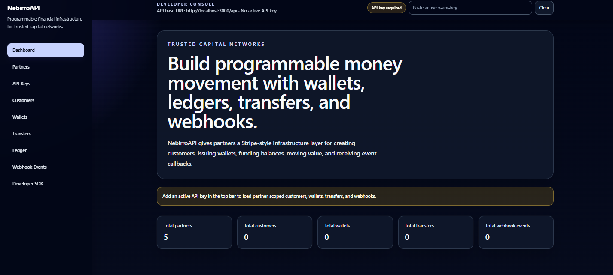
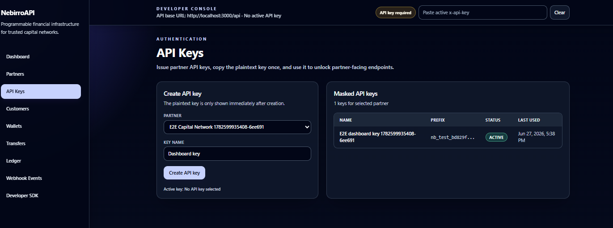
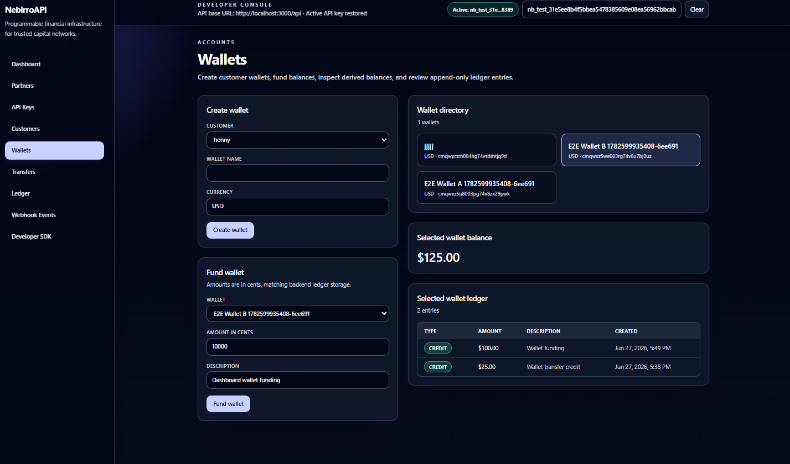
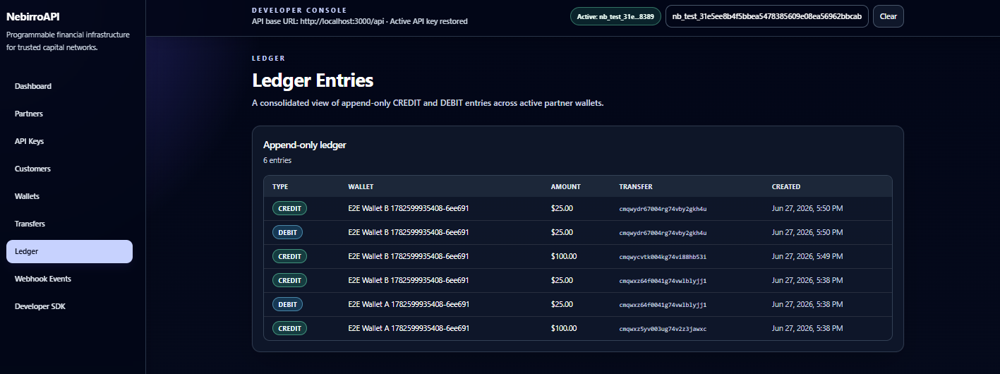
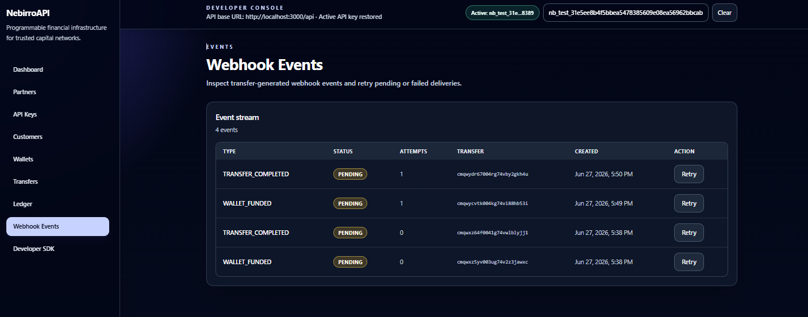
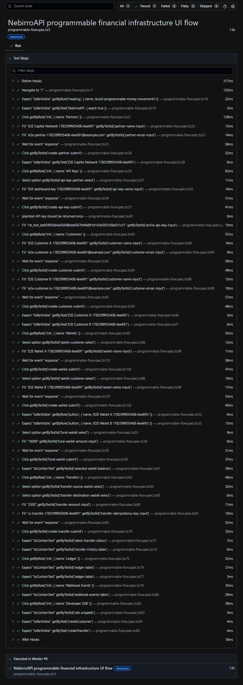

# NebirroAPI


Stripe-style programmable financial infrastructure for trusted capital networks.

NebirroAPI demonstrates how a partner-facing financial platform can onboard partners, issue scoped API keys, create customers and wallets, move value, derive balances from an immutable ledger, enforce idempotency, emit webhook events, expose Swagger docs, and provide a TypeScript SDK plus React dashboard.

## Why This Project Exists

Capital platforms need more than a simple payment form. They need reliable infrastructure for partner-scoped access, ledger-derived balances, duplicate-safe money movement, developer documentation, and operational visibility.

NebirroAPI is a compact portfolio-grade version of that infrastructure.

## Merchant Network — first-product pilot

The new `/merchant-network` workspace extends this API into merchant profiles, grain offers, stock-reserving agreements, delivery evidence, manually verified ETB payment references, completed trade history, and purchase-linked inventory financing applications. It is an operator-assisted pilot; it does not approve loans or move money.

See [pilot scope, setup, API and launch gates](docs/merchant-network-pilot.md). Both a partner API key and a separately configured `MERCHANT_OPERATOR_KEY` are required. Existing financial-console routes remain demo infrastructure.

## Core Features

- Partner onboarding and API key issuance.
- Partner-scoped customers and wallets.
- Wallet funding through ledger `CREDIT` entries.
- Wallet-to-wallet transfers through source `DEBIT` and destination `CREDIT` entries.
- Ledger-derived wallet balances instead of mutable stored balances.
- Idempotency keys for duplicate-safe transfer creation.
- Webhook endpoint and webhook event resources.
- Swagger/OpenAPI documentation.
- TypeScript SDK package for external developers.
- React developer dashboard for API operations.
- Jest unit tests, backend API integration tests, demo script, and Playwright E2E tests.

## Tech Stack

| Layer | Technologies |
| --- | --- |
| Backend | Node.js, TypeScript, NestJS, Prisma, PostgreSQL, Swagger/OpenAPI, Jest |
| Frontend | React, TypeScript, Vite, React Router, Axios, Tailwind CSS, Playwright |
| SDK | TypeScript client package |
| Infrastructure | Docker Compose, PostgreSQL |
| Testing | Jest, Supertest/Nest integration tests, Playwright browser E2E tests |

## Architecture

```text
nebirro-api/
├─ backend/    NestJS API, Prisma schema, services, controllers, tests, demo script
├─ frontend/   React developer dashboard and Playwright E2E tests
├─ sdk/        TypeScript SDK for external integrations
└─ docker-compose.yml
```

Controllers keep HTTP concerns thin. Services own business rules such as funding, transfer validation, ledger writes, webhook event creation, and idempotency behavior.

## Ledger Model

The ledger is the source of truth.

- Every wallet starts at balance `0`.
- Funding a wallet creates a `CREDIT` ledger entry.
- A wallet-to-wallet transfer creates one source `DEBIT` and one destination `CREDIT`.
- Transfers fail when the source wallet has insufficient funds.
- Balances are calculated from ledger history.
- Ledger entries are append-only through the public API.

## API Overview

Swagger is available at:

```text
http://localhost:3000/api/docs
```

Core resources:

- Partners
- API Keys
- Customers
- Wallets
- Capital Programs
- Transfers
- Webhook Endpoints
- Webhook Events

## Dashboard

The React dashboard provides a developer-console interface for operating the API:

- Dashboard summary cards.
- Partner creation.
- API key creation and local activation.
- Customer management.
- Wallet creation, funding, balance inspection, and ledger review.
- Wallet-to-wallet transfers with idempotency support.
- Consolidated ledger view.
- Webhook event listing and retry.
- Developer SDK usage snippets.

## Screenshots

### Dashboard


### API Key Management


### Wallet Funding And Balances


### Ledger Entries


### Webhook Events


### Playwright E2E Passing


## Run Locally

Install dependencies:

```bash
npm install
```

Start PostgreSQL and the backend:

```bash
docker compose up -d postgres backend
```

Start the frontend:

```bash
npm run dev -w frontend
```

Useful URLs:

- API: `http://localhost:3000/api`
- Health: `http://localhost:3000/api/health`
- Swagger: `http://localhost:3000/api/docs`
- Frontend: `http://localhost:5173`

## Test Commands

Backend unit tests:

```bash
npm test -w backend
```

Backend integration tests:

```bash
docker compose up -d postgres
npm run test:integration -w backend
```

Frontend build:

```bash
npm run build -w frontend
```

SDK build:

```bash
npm run build -w sdk
```

Playwright E2E:

```bash
docker compose up -d postgres backend
npm exec -w frontend -- playwright install chromium
npm run test:e2e -w frontend
```

## Demo Flow

Run the portfolio demo script:

```bash
docker compose up -d postgres backend
npm run demo:flow -w backend
```

The demo walks through partner creation, API key issuance, customer creation, wallet creation, wallet funding, wallet-to-wallet transfer, ledger debit/credit inspection, webhook event creation, and idempotency preventing duplicate transfer creation.

## Future Improvements

- Signed outbound webhook delivery with retries and exponential backoff.
- Role-based dashboard auth for operators.
- More complete capital program workflows.
- Multi-currency constraints and FX handling.
- Ledger reconciliation reports.
- Pagination and filtering for high-volume resources.
- Production-grade secret management and key rotation.
- Published SDK package with generated API types.

## Portfolio / Resume Bullet

Built NebirroAPI, a Stripe-style programmable financial infrastructure platform using NestJS, TypeScript, PostgreSQL, Prisma, Docker, partner API keys, ledger-derived balances, idempotent transfers, webhook events, a TypeScript SDK, a React/TypeScript developer dashboard, Jest integration testing, and Playwright browser E2E coverage.
